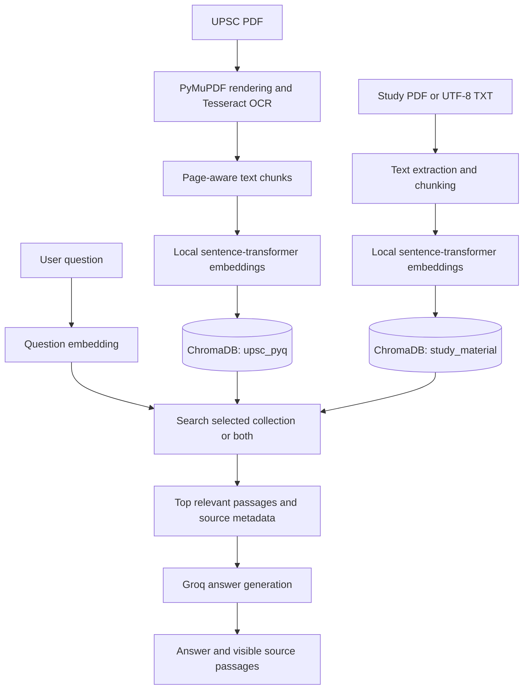

# UPSC PYQ RAG Assistant

A local study assistant that searches UPSC previous-year questions (PYQs) and personal study notes, then uses retrieved passages to help answer a learner's question.

This project demonstrates a practical retrieval-augmented generation (RAG) workflow: OCR and text processing, local semantic embeddings, persistent vector storage, retrieval with source references, and answer generation through Groq. It is an educational project, not a source of guaranteed or complete exam guidance.

## The problem

Relevant examples and explanations can be hard to find across long question papers and scattered revision notes. This project makes those documents searchable by meaning and presents the passages used for an answer so that a learner can review the underlying material.

## Features

- OCR extraction from the configured UPSC General Studies PDF.
- Page-aware chunking and semantic embeddings using `sentence-transformers/all-MiniLM-L6-v2`.
- Persistent local ChromaDB storage with separate `upsc_pyq` and `study_material` collections.
- Study-note ingestion from PDF and UTF-8 TXT files.
- Search of PYQ content, study notes, or both.
- Groq-powered answers prompted to stay within retrieved context, report insufficient evidence, and cite source filenames and page numbers when available.
- A lightweight local web interface with a collection selector and controls for showing passages before or after the answer.
- Markdown answer display with HTML sanitization; retrieved text and source metadata remain visible.
- A small four-case evaluation script for the included Ashokan inscriptions note.

## Technology stack

| Technology | Role in this project |
| --- | --- |
| Python | Runs the ingestion, retrieval, evaluation, and web application code. |
| PyMuPDF (`pymupdf`) | Reads PDF pages and provides rendered page images for OCR when needed. |
| Tesseract OCR and `pytesseract` | Extracts text from scanned question-paper pages and scanned study-note pages. |
| Pillow | Converts rendered PDF pages into images for OCR. |
| Sentence Transformers | Creates local embeddings with `sentence-transformers/all-MiniLM-L6-v2` for documents and search questions. |
| ChromaDB | Persists vectors, document text, and metadata locally for semantic search. |
| Groq Python SDK | Sends retrieved context to the configured Groq model for answer generation. |
| `python-dotenv` | Loads Groq configuration from the project-root `.env` file. |
| `markdown-it-py` | Renders answer Markdown in the web interface; rendered HTML is sanitized before display. |
| Python `http.server` | Serves the local web interface without a separate web framework. |

## How the RAG workflow works

RAG means retrieval-augmented generation. The application first finds relevant passages in the indexed materials, then gives those passages to the language model as context for a response. The model is instructed to identify when the retrieved text does not support an answer. The retrieved passages and their source information are also shown in the interface.



Both collections use the persistent database directory `data/chroma_db/`. The PYQ embedding stage writes `data/embeddings.json`; the vector-store script uses those existing vectors. Study-material ingestion creates embeddings for study files and upserts them into the separate `study_material` collection.

## Repository structure

The following layout reflects the current project. Generated local artifacts and `.env` are listed to explain where the workflow uses them; they are not required source files for a fresh checkout.

```text
UPSC-PYQ-RAG/
|-- app/
|   |-- check_study_material.py  # Report study files and indexed record counts
|   |-- chunk.py                 # Split OCR text into page-aware chunks
|   |-- embed.py                 # Generate local embeddings for PYQ chunks
|   |-- ingest.py                # OCR the configured General Studies PDF
|   |-- ingest_study_material.py # Extract, chunk, embed, and store study PDFs/TXT
|   |-- rag.py                   # Command-line retrieval and Groq answers
|   |-- retrieve.py              # Semantic search across selected collections
|   |-- test_rag.py              # Four-case live check for the sample study note
|   |-- vector_store.py          # Store precomputed PYQ embeddings in ChromaDB
|   `-- web.py                   # Local question-and-answer web interface
|-- data/
|   |-- QP-CSM-26-010926-GENERAL STUDIES PAPER - I.pdf # Configured PYQ input
|   |-- UPSC_Prelims_2026_PYQ.pdf                      # Local PDF in this checkout
|   |-- extracted_text.txt       # Generated OCR text
|   |-- chunks.json              # Generated PYQ chunks
|   |-- embeddings.json          # Generated PYQ embeddings
|   |-- chroma_db/               # Persistent local ChromaDB data
|   `-- study_material/
|       `-- ashokan_inscriptions.txt # Sample study note
|-- .env                        # Local Groq settings; create locally, do not commit
|-- .gitignore
|-- requirements.txt
`-- README.md
```

## Windows setup

Open PowerShell in the project folder. The project already has a `venv` virtual environment; use its Python executable directly:

```powershell
cd C:\UPSC-PYQ-RAG
.\venv\Scripts\python.exe -m pip install -r requirements.txt
```

If setting up a fresh checkout that does not contain a virtual environment, create one first:

```powershell
py -m venv venv
.\venv\Scripts\python.exe -m pip install -r requirements.txt
```

For OCR, install Tesseract at `C:\Program Files\Tesseract-OCR\tesseract.exe`. `app/ingest.py` uses that configured path directly. Scanned study-note PDF pages also use this Tesseract path when the PDF has no extractable text. The first embedding run may download the sentence-transformer model, so internet access may be needed once.

## Configure Groq locally

The project loads `.env` from the repository root, regardless of the terminal's current folder. Create or edit that file locally:

```powershell
notepad .env
```

Add your own settings in this format, replacing the placeholders inside the local file:

```dotenv
GROQ_API_KEY=your_groq_api_key
GROQ_MODEL=your_groq_model_id
```

Keep `.env` private. It is listed in `.gitignore`; do not paste the real key into source code, README files, screenshots, or public issue reports. A valid configured Groq model and API key are needed for generated answers and for the live evaluation. Do not share your key with anyone.

## Run the application

From the project root, start the local web app with:

```powershell
.\venv\Scripts\python.exe app\web.py
```

Open <http://127.0.0.1:8000> in your browser. Choose **Study material**, **PYQ**, or **Study material and PYQ**, enter a question, and choose whether retrieved passages appear before or after the answer. The default bind address is localhost (`127.0.0.1`); press `Ctrl+C` in PowerShell to stop the server.

Example questions:

- What do Ashokan inscriptions tell us about Mauryan administration?
- Which languages and scripts were used in Ashoka's inscriptions?
- What ethical principles were associated with Ashoka's Dhamma?
- Which passages in the PYQ collection relate to a topic I am revising?

Answers depend on the indexed material and the configured Groq service. Review the displayed passages and citations, especially when OCR may have introduced errors.

## Add or rebuild indexed material

### Add personal study notes

Copy PDF or UTF-8 TXT notes into `data/study_material/`, then run:

```powershell
.\venv\Scripts\python.exe app\ingest_study_material.py
.\venv\Scripts\python.exe app\check_study_material.py
```

The ingestion script uses the `study_material` collection and preserves source filenames and PDF page numbers when available. The status script reports indexed file and chunk counts without displaying note contents.

### Rebuild the PYQ index

The PYQ OCR script is configured for `data/QP-CSM-26-010926-GENERAL STUDIES PAPER - I.pdf`. If you intentionally need to regenerate the PYQ artifacts, run the stages in order:

```powershell
.\venv\Scripts\python.exe app\ingest.py
.\venv\Scripts\python.exe app\chunk.py
.\venv\Scripts\python.exe app\embed.py
.\venv\Scripts\python.exe app\vector_store.py
```

These commands rewrite their generated text, chunk, or embedding outputs. The vector-store step upserts the existing embeddings into `upsc_pyq`; it does not generate embeddings again. They are not needed just to start the web app if the database is already present.

## Evaluation

The repository includes a small check with three answerable questions and one unsupported question about `ashokan_inscriptions.txt`. Run it with:

```powershell
.\venv\Scripts\python.exe app\test_rag.py
```

It checks retrieved note text and source citations, and expects the unsupported answer to begin with `Insufficient context:`. This script makes four live Groq requests and requires the note to be indexed, a working internet connection, and Groq configuration in the root `.env`. This is a narrow initial check, not a general accuracy benchmark or guarantee. This README was updated based on code inspection; the evaluation was not run as part of this documentation change.

## Current limitations and possible improvements

- OCR can misread scanned text; review extracted text and cited passages before relying on them.
- The PYQ ingestion script targets one configured PDF and a Windows-specific Tesseract path.
- Retrieval returns up to three passages and uses the configured ChromaDB distance ordering; retrieval quality depends on the indexed documents and query wording.
- The evaluation contains only four questions about one sample note and does not measure broad answer accuracy.
- The web app is a local prototype with no user accounts, authentication, or deployment configuration. It has not been deployed online.
- Groq answer generation requires network access and sends the question plus retrieved passages to the configured Groq service; do not index material you are not permitted to share with that service.

Possible next improvements include broader retrieval and citation evaluations, configurable result counts and filters, support for selecting additional source documents, and deployment hardening if the project is later hosted.
