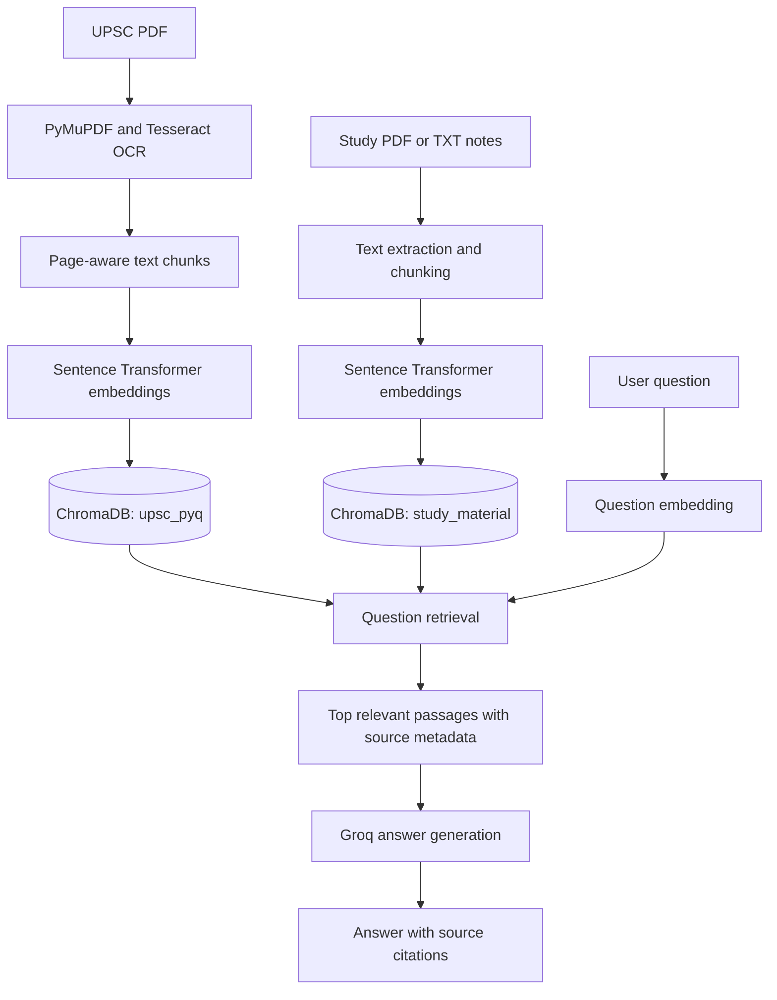

# UPSC PYQ RAG

**A source-grounded study assistant for exploring UPSC previous-year questions (PYQs) and personal study notes.**

UPSC aspirants often search across long question papers and scattered revision notes to find relevant examples and source passages. This project turns those documents into searchable chunks and uses retrieval-augmented generation (RAG) to answer questions with references to the material that was retrieved.

The project is a local, educational prototype. It does not guarantee factual completeness or exam outcomes. Verify important claims against the cited source material.

## Features

- OCR of the configured UPSC PDF using PyMuPDF, Tesseract, and Pillow.
- Page-aware chunking and local semantic embeddings with `sentence-transformers/all-MiniLM-L6-v2`.
- Persistent ChromaDB storage in separate `upsc_pyq` and `study_material` collections.
- Ingestion of PDF and UTF-8 TXT study notes without replacing the PYQ collection.
- Retrieval across either collection or both, with source, page (when available), and chunk references.
- Groq-powered answers instructed to use retrieved context and report when evidence is insufficient.
- A local web interface with collection and passage-display controls.
- A small, four-question live evaluation script for the Ashokan inscriptions note.

## Technology

Python, PyMuPDF, Tesseract OCR, Pillow, `sentence-transformers`, ChromaDB, Groq Python SDK, `python-dotenv`, `markdown-it-py`, and Python's built-in HTTP server.

The web interface in `app/web.py` uses `http.server`; this project does not currently use FastAPI or a frontend framework.

## RAG architecture



The two collections share the persistent database directory `data/chroma_db/`. The study-material ingestion script upserts into `study_material`; the PYQ vector-store script upserts the precomputed records into `upsc_pyq`.

## Project layout

```text
UPSC-PYQ-RAG/
├── app/
│   ├── ingest.py                  # OCR the configured UPSC PDF
│   ├── chunk.py                   # Create page-aware PYQ chunks
│   ├── embed.py                   # Generate local PYQ embeddings
│   ├── vector_store.py            # Store PYQ embeddings in ChromaDB
│   ├── ingest_study_material.py   # Ingest PDFs/TXT into a separate collection
│   ├── check_study_material.py    # Read-only study index status
│   ├── retrieve.py                # Search PYQ, notes, or both
│   ├── rag.py                     # CLI retrieval and Groq answer generation
│   ├── test_rag.py                 # Four-case live Groq evaluation
│   └── web.py                     # Local web interface
├── data/
│   ├── QP-CSM-26-010926-GENERAL STUDIES PAPER - I.pdf
│   ├── UPSC_Prelims_2026_PYQ.pdf
│   ├── extracted_text.txt         # Generated OCR output (ignored by Git)
│   ├── chunks.json                # Generated chunks (ignored by Git)
│   ├── embeddings.json            # Generated embeddings (ignored by Git)
│   ├── chroma_db/                 # Persistent vector database (ignored by Git)
│   └── study_material/
│       └── ashokan_inscriptions.txt
├── .env                           # Local credentials; ignored by Git
├── .gitignore
├── requirements.txt
└── README.md
```

The PDF filenames and sample note above reflect the current project files. Local generated files and credentials are not intended for source control.

## Windows setup

From PowerShell:

```powershell
cd C:\UPSC-PYQ-RAG
py -m venv venv
.\venv\Scripts\python.exe -m pip install -r requirements.txt
```

The OCR scripts expect Tesseract at `C:\Program Files\Tesseract-OCR\tesseract.exe`. Install Tesseract at that location, or update `TESSERACT_EXE` in `app/ingest.py` if it is installed elsewhere. The first embedding run may need internet access to download the sentence-transformer model; later runs can use the local model cache.

## Groq configuration

Create or edit the **project-root** `.env` file (never commit it) with your own Groq credentials:

```dotenv
GROQ_API_KEY=your_groq_api_key
GROQ_MODEL=your_groq_model_id
```

Replace the placeholders locally. Do not paste credentials into source code, README files, screenshots, or issue reports. The RAG and evaluation scripts load `.env` from the project root. Keep `.env` ignored by Git.

## Ingestion commands

### UPSC PDF to PYQ collection

Run these stages in order from the project root:

```powershell
.\venv\Scripts\python.exe app\ingest.py
.\venv\Scripts\python.exe app\chunk.py
.\venv\Scripts\python.exe app\embed.py
.\venv\Scripts\python.exe app\vector_store.py
```

`app/ingest.py` reads the configured General Studies PDF and writes `data/extracted_text.txt`. The following scripts write `data/chunks.json`, `data/embeddings.json`, then persist the existing embeddings in `data/chroma_db/` under `upsc_pyq`. Running OCR, chunking, or embedding again rewrites its generated output file.

### Personal study material

Put PDF or UTF-8 TXT notes in `data/study_material/`, then run:

```powershell
.\venv\Scripts\python.exe app\ingest_study_material.py
.\venv\Scripts\python.exe app\check_study_material.py
```

PDF pages retain page metadata when available; TXT records retain the source filename. Re-ingestion upserts current chunks into the separate `study_material` collection and removes stale chunks for a source file that has changed.

## Ask a question

Start the local web app:

```powershell
.\venv\Scripts\python.exe app\web.py
```

Open <http://127.0.0.1:8000>, choose whether to search study material, PYQ, or both, and submit a question. For example:

> What do Ashokan inscriptions tell us about Mauryan administration?

The app retrieves relevant passages, displays their source and chunk metadata, and asks Groq to answer from those passages. For a TXT note, no page number is available; the filename is displayed instead. To use the command-line RAG interface:

```powershell
.\venv\Scripts\python.exe app\rag.py --source study --passages after "What do Ashokan inscriptions tell us about Mauryan administration?"
```

## Evaluation

Run the existing four-case evaluation with:

```powershell
.\venv\Scripts\python.exe app\test_rag.py
```

It checks three answerable questions about `ashokan_inscriptions.txt` and one question whose answer is not in that note. It makes **four live Groq chat-completion requests** and requires the unsupported case to begin with `Insufficient context:`.

The project previously reported **4/4 checks passed**. This is a small initial check against one study note, not a broad benchmark or an accuracy guarantee. Results depend on the available indexed records, embedding model, Groq model, and network/API availability. This README update did not rerun the live evaluation.

## Limitations and possible next steps

- The evaluation covers only four questions and one sample note.
- OCR quality depends on scan quality and Tesseract; extracted text should be reviewed.
- Retrieval uses a fixed top-three result count and does not yet expose configurable filters or ranking thresholds.
- The project is a local single-process prototype; it has no authentication, user management, deployment setup, or frontend framework.
- The PYQ OCR script is configured for one PDF filename, and the OCR executable path is Windows-specific.
- Improve evaluation coverage, add citation-quality checks, and test retrieval across a larger set of PDFs and notes before relying on it for high-stakes study decisions.

## GitHub repository description

> Local UPSC PYQ and study-note RAG assistant with OCR, semantic search, ChromaDB, source-grounded Groq answers, and a lightweight web UI.
